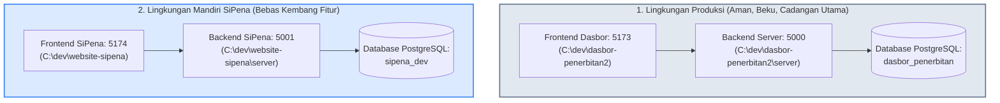

# 📘 DOKUMENTASI LENGKAP PENGEMBANGAN SIPENA & MANAJEMEN PENERBITAN
**Tanggal Penyusunan:** 12 - 14 Oktober 2026  
**Status Lingkungan:** Lokal & Ter-push ke Git (Local Development & Synchronized to GitHub)

---

## 📌 DAFTAR ISI
1. [Latar Belakang & Tujuan Integrasi](#1-latar-belakang--tujuan-integrasi)
2. [Arsitektur Sistem & Isolasi CSS](#2-arsitektur-sistem--isolasi-css)
3. [Standarisasi Desain (design.md) & Pemulihan Halaman Login](#3-standarisasi-desain-designmd--pemulihan-halaman-login)
4. [Logika Cerdas Redirect Login (Smart Redirect)](#4-logika-cerdas-redirect-login-smart-redirect)
5. [Restrukturisasi Navigasi & Ruang Kerja (Workspace)](#5-restrukturisasi-navigasi--ruang-kerja-workspace)
6. [Perancangan & Penyesuaian Skema Database Terintegrasi](#6-perancangan--penyesuaian-skema-database-terintegrasi)
7. [Hierarki Hak Akses 3 Tingkat (Super Admin vs Reviewer vs Pegawai)](#7-hierarki-hak-akses-3-tingkat-super-admin-vs-reviewer-vs-pegawai)
8. [Daftar File yang Diubah](#8-daftar-file-yang-diubah)
9. [Panduan Pengujian Lengkap (Testing Guide Awal)](#9-panduan-pengujian-lengkap-testing-guide-besok)
10. [Pembaruan Lanjutan: Menu Bantuan & Standarisasi Kolom Pencarian UI](#10-pembaruan-lanjutan-menu-bantuan--standarisasi-kolom-pencarian-ui)
11. [Pembaruan Visual: Presisi Flexbox Search Bar & Perapihan Timeline Tahapan Proyek](#11-pembaruan-visual-presisi-flexbox-search-bar--perapihan-timeline-tahapan-proyek)
12. [Restorasi Penuh UI/UX Asli Dasbor Manajemen Penerbitan (Paritas Penuh C:\dev\dasbor-penerbitan2)](#12-restorasi-penuh-uiux-asli-dasbor-manajemen-penerbitan-paritas-penuh-cdevdasbor-penerbitan2)
13. [Investigasi & Solusi Tabrakan CSS (Admin SiPena vs Dasbor Penerbitan)](#13-investigasi--solusi-tabrakan-css-admin-sipena-vs-dasbor-penerbitan)
14. [Sinkronisasi Paritas Penuh Detail Proyek (ProjectDetail.jsx) & Stabilitas Timeline](#14-sinkronisasi-paritas-penuh-detail-proyek-projectdetailjsx--stabilitas-timeline)
15. [Strategi Isolasi Backend & Database SiPena (Total Decoupling Strategy)](#15-strategi-isolasi-backend--database-sipena-total-decoupling-strategy)
16. [Sinkronisasi Fitur "Hak Admin Reviewer" & Level Akun ke Dasbor Produksi (dasbor-penerbitan2)](#16-sinkronisasi-fitur-hak-admin-reviewer--level-akun-ke-dasbor-produksi-dasbor-penerbitan2)
17. [Investigasi & Solusi Tuntas Tombol QC ("Setujui" & "Tolak / Revisi") pada Akun Reviewer di localhost:5173](#17-investigasi--solusi-tuntas-tombol-qc-setujui--tolak--revisi-pada-akun-reviewer-di-localhost5173)
18. [Riwayat Commit & Push Git ke Dua Repositori Terpisah](#18-riwayat-commit--push-git-ke-dua-repositori-terpisah)
19. [Daftar Akun Dummy Pengujian Seluruh Peran (Role Credentials)](#19-daftar-akun-dummy-pengujian-seluruh-peran-role-credentials)

---

## 1. Latar Belakang & Tujuan Integrasi

Sebelumnya, sistem terpisah menjadi dua entitas:
1. **Website Publik & Portal Admin SiPena** (`website-sipena`)
2. **Dasbor Alur Kerja Penerbitan** (`dasbor-penerbitan2`) yang berjalan mandiri di port terpisah dengan login terpisah.

### Tujuan Utama:
- **Penyatuan Total (Unified Experience)**: Menyatukan seluruh alur produksi penerbitan ke dalam SiPena, sehingga cukup menjalankan **1 Frontend Vite** dan **1 Backend Server API**.
- **Single Sign-On (SSO)**: Satu sesi autentikasi berlaku untuk seluruh portal (publik, admin SiPena, dan alur kerja manajemen penerbitan).
- **Kepastian Lokal**: Seluruh pengerjaan hanya diterapkan pada lingkungan lokal.

---

## 2. Arsitektur Sistem & Isolasi CSS

### Arsitektur Port & Service:
- **Frontend**: `http://localhost:5174` (atau `5173`) — Single Page Application (React + Vite + React Router).
- **Backend API**: `http://localhost:5000` — Express.js + Drizzle ORM + PostgreSQL + Better-Auth.

### Masalah Awal & Solusi Isolasi CSS:
- **Masalah**: Penggabungan file CSS alur kerja (`manajemen.css`) ke `main.jsx` merusak gaya visual halaman publik SiPena dan form login karena adanya CSS reset global (`body`, `*`, `input`, `.btn-primary`).
- **Solusi**:
  1. Impor `manajemen.css` dicabut dari `main.jsx`.
  2. Seluruh aturan CSS alur kerja dibungkus ketat di bawah selektor `.manajemen-scope` menggunakan `:where(.manajemen-scope)` dengan spesifisitas nol (disempurnakan di Bab 12 & 13).
  3. File styling alur kerja hanya dimuat pada layout manajemen (`ManagementLayout.jsx`), menjamin **100% tampilan publik SiPena maupun Dasbor Admin SiPena tidak terpengaruh**.

---

## 3. Standarisasi Desain (design.md) & Pemulihan Halaman Login

### A. Dokumen Standar Desain (`design.md`)
Telah dibuat dokumen panduan baku [design.md](file:///c:/dev/website-sipena/design.md) yang mengunci:
- **Warna Aksen Utama**: `#2563eb` (Royal Blue SiPena), hover `#1d4ed8`.
- **Latar Belakang**: `#f1f5f9` (Light Slate Grey).
- **Teks**: `#0f172a` (Primary Heading/Text) dan `#64748b` (Secondary).
- **Tipografi**: Judul menggunakan `'Poppins'`, isi teks & form menggunakan `'Inter'`, kode/NIP menggunakan monospace.

### B. Pemulihan Halaman Login (`LoginPage.jsx` & `LoginPage.css`)
- Mengembalikan kartu form login ke bentuk presisi asli (lebar 500px, sudut melengkung 16px, bayangan halus).
- Tombol tab switcher *Masuk* dan *Daftar* dengan indikator aktif warna biru SiPena.
- Kotak bantuan akun demo (*Credential Box*) berwarna biru muda `#eff6ff` dengan border tipis dan ikon kunci 🔑.

---

## 4. Logika Cerdas Redirect Login (Smart Redirect)

Implementasi alur pengalihan setelah pengguna berhasil login:
1. **Redirect Berdasarkan Konteks Terakhir (Opsi Cerdas)**:
   - Jika pengunjung sedang membaca detail buku atau mengunduh buku lalu diminta login, setelah login sistem akan mengembalikan pengguna langsung ke halaman buku tersebut.
2. **Login Biasa sebagai Pegawai/Admin**:
   - Jika pegawai atau admin melakukan login melalui tombol "Masuk" di beranda utama, sistem otomatis mengarahkan ke **Dasbor Admin SiPena** (`/admin`).
3. **Pemberitahuan Akun Pending**:
   - Jika pegawai baru mendaftar dan statusnya masih `pending`, sistem mencegah login dan menampilkan pesan informatif bahwa akun sedang menunggu persetujuan Super Administrator.

---

## 5. Restrukturisasi Navigasi & Ruang Kerja (Workspace)

### A. Header SiPena Publik
- Di header dasbor admin, teks **SiPena: SISTEM INFORMASI PENERBITAN** kini dapat diklik dan langsung mengarahkan ke halaman publik website SiPena (`/`).

### B. Pemisahan Ruang Kerja Alur Kerja Penerbitan (Opsi 1 Workspace)
- **Sebelumnya**: Menu "Manajemen Penerbitan" di sidebar admin memiliki deretan sub-menu panjang yang memenuhi layar dan membingungkan navigasi.
- **Kini**:
  1. Di sidebar admin SiPena, **"Manajemen Penerbitan"** adalah menu mandiri yang rapi.
  2. Saat diklik, pengguna masuk ke **Ruang Kerja Alur Produksi** terpisah (`/admin/manajemen`).
  3. Memiliki sidebar khusus alur redaksi (*Dasbor Produksi, Alur Kerja Kanban, Generator NIP, SOP Dokumen, Chat Tim, Arsip, Tong Sampah, Laporan, Pengaturan*).
  4. Tersedia tombol navigasi cepat: `← Kembali ke Admin SiPena` dan `🌐 Ke Web Publik`.

---

## 6. Perancangan & Penyesuaian Skema Database Terintegrasi

Salah satu fondasi terpenting dari integrasi ini adalah **penyatuan skema database PostgreSQL menggunakan Drizzle ORM** (`server/src/db/schema.ts`). Sebelumnya, SiPena dan Manajemen Penerbitan memiliki model data terpisah. Kini seluruh entitas terhubung dalam satu database terpadu:

```
[users] ──┬── (1:N) ──► [manuscripts] ── (1:1) ──► [projects] ── (1:1) ──► [books]
          ├── (1:N) ──► [stages] (PJ / Reviewer)
          ├── (1:N) ──► [book_ratings] & [book_downloads]
          └── (1:N) ──► [notifications] & [audit_log]
```

### A. Entitas Tabel Inti & Penyesuaian Kolom

#### 1. Tabel `user` (Tabel Pengguna Terpadu)
Menggabungkan kebutuhan autentikasi Better-Auth, profil lengkap pengunjung/penulis SiPena, dan profil pegawai redaksi:
- **Field Autentikasi**: `id`, `name`, `email`, `email_verified`, `image`, `created_at`, `updated_at`.
- **Field Peran & Otoritas**:
  - `role`: `'admin'` | `'personil'` | `'pengunjung'` | `'calon_penulis'` | `'penulis'` | `'reviewer'`.
  - `status`: `'pending'` | `'active'` | `'disabled'`.
  - `is_reviewer`: `boolean default false` *(kolom baru hasil migrasi)* untuk hak review Kanban mandiri.
- **Field Kepegawaian & Tim Redaksi**:
  - `skills`: `jsonb` (array keahlian: editor, tata letak, desain, qc, isbn, dll.).
  - `telegram_chat_id`, `telegram_link_token`, `phone`.
- **Field Profil Publik SiPena**:
  - `tempat_lahir`, `tanggal_lahir`, `pekerjaan`, `instansi`.
  - `alamat_lengkap`, `provinsi`, `kota`, `kecamatan`, `kelurahan`.
  - `bio`, `website`, `karya_eksternal` (`jsonb` buku eksternal penulis).

#### 2. Tabel Autentikasi Single Sign-On (Better-Auth)
- `session`: Menyimpan token sesi aktif, IP address, user agent, dan masa berlaku sesi.
- `account`: Menyimpan hash password dan kredensial autentikasi.
- `verification`: Penanganan token verifikasi email / OTP.

#### 3. Tabel `projects` (Proyek Penerbitan)
Merekam setiap proyek buku/konten yang sedang diproduksi:
- `id` (format: `PRJ-YYYY-XXXX`), `title`, `category` (`terbitan`, `medsos`, `keuangan`, dll.).
- `type` (`reguler`, `khusus`, dll.), `workflow_type` (`sequential`, `parallel`).
- `status` (`active`, `archived`), `gdrive_link`, `score`, `page_count`.
- `deleted_at`: Soft-delete proyek ke Tong Sampah.

#### 4. Tabel `stages` (Tahapan Kanban Alur Kerja)
Merekam kartu pekerjaan di dalam setiap proyek:
- `id` (uuid), `project_id` (FK &rarr; `projects.id`), `label`, `order`, `status` (`draft`, `active`, `review`, `revision`, `done`).
- `pj_id` (FK &rarr; `user.id`), `co_pj_ids` (`jsonb` array hingga 2 kolaborator).
- `deadline`, `progress`, `result_link`, `score`.
- `notes`: `jsonb` (catatan/pesan diskusi per tahap).
- `revision_reason`, `revision_count`, `approved_at`, `revised_at`.
- `reviewer_id` (FK &rarr; `user.id`): Merekam admin/reviewer yang menyetujui tahapan.

#### 5. Tabel `manuscripts` (Naskah SiPena &rarr; Proyek)
Menghubungkan pengajuan naskah publik ke dapur redaksi:
- `id`, `title`, `author_id` (FK &rarr; `user.id`), `synopsis`, `category`, `file_url`.
- `status` (`pending`, `reviewed`, `approved`, `rejected`), `reviewer_notes`.
- `project_id` (FK &rarr; `projects.id`): Ketika naskah disetujui, otomatis terhubung ke proyek alur kerja di manajemen penerbitan.

#### 6. Tabel `books` (Katalog Buku SiPena Publik)
Menghubungkan hasil terbitan produksi ke etalase publik:
- `id`, `title`, `author_id` (FK &rarr; `user.id`), `year`, `isbn`, `isbn_digital`.
- `cover_url`, `file_url` (PDF/EPUB), `audio_url`, `category`, `synopsis`.
- `rating_avg`, `rating_count`, `download_count`, `status` (`draft`, `published`, `archived`).
- `project_id` (FK &rarr; `projects.id`): Terhubung langsung ke riwayat produksi buku.

#### 7. Tabel Pendukung Lainnya
- `book_ratings` & `book_downloads`: Statistik interaksi publik buku dengan indeks unik (`user_id`, `book_id`).
- `nip_records`: Arsip NIP barcode penerbitan (`barcode`, `visual_format`, `ddc_code`, `serial_number`, dll.).
- `documents`: SOP dokumen & arsip digital dengan dukungan soft delete (`deleted_at`).
- `audit_log`: Pencatatan log aktivitas sistem (keamanan, aksi persetujuan, dan perubahan akun).
- `app_settings`: Pengaturan kategori alur kerja & kode DDC yang tersimpan di DB (bukan sekadar `localStorage`).
- `chat_conversations` & `chat_messages`: Komunikasi tim internal terintegrasi.

---

### B. Relasi Antar Tabel (Drizzle Relations)
Telah didefinisikan relasi lengkap menggunakan `relations()` pada `schema.ts`:
- `usersRelations`: Berelasi dengan `stages` (sebagai PJ, Co-PJ, dan Reviewer), `books` (sebagai penulis), `manuscripts`, `notifications`, dan `auditLogs`.
- `projectsRelations`: Berelasi dengan `stages`, `book` (1-to-1), dan `manuscript` (1-to-1).
- `stagesRelations`: Berelasi dengan `project`, `pj` (User), `coPj` (User), dan `reviewer` (User).

---

### C. Migrasi Database yang Dijalankan
1. **Migrasi `is_reviewer`**:
   - Dieksekusi via skrip PostgreSQL untuk menambahkan kolom `is_reviewer BOOLEAN DEFAULT FALSE` pada tabel `"user"`.
   - Terverifikasi ada di database: `SELECT column_name, data_type FROM information_schema.columns WHERE table_name = 'user';`.
2. **Mekanisme Auto-Migration Saat Boot**:
   - Fungsi `runMigrations()` di `server/src/index.ts` memastikan setiap kolom baru (`is_reviewer`, field profil SiPena, dll.) otomatis dibuat jika belum ada di database lokal saat server dinyalakan.

---

## 7. Hierarki Hak Akses 3 Tingkat (Super Admin vs Reviewer vs Pegawai)

Untuk memecahkan masalah personil yang diberikan hak reviewer Kanban ikut memegang kendali penuh pengguna, sistem hak akses dipisahkan menjadi 3 tingkat independen:

### Matriks Peran & Izin:

| Hak Akses / Fitur | Super Administrator (`role: 'admin'`) | Admin Reviewer (`is_reviewer: true`) | Pegawai Biasa (`role: 'personil'`) | Pengunjung / Penulis (`role: 'pengunjung'`) |
| :--- | :---: | :---: | :---: | :---: |
| **Kelola Website Publik SiPena (`/admin`)** | ✅ Ya | ✅ Ya | ✅ Ya | ❌ Tidak |
| **Approval Pengunjung & Penulis** | ✅ Ya | ✅ Ya | ✅ Ya | ❌ Tidak |
| **Approval Naskah Buku Baru** | ✅ Ya | ✅ Ya | ✅ Ya | ❌ Tidak |
| **Approval Akun Pegawai Baru** | ✅ Ya | ❌ Tidak (Terkunci) | ❌ Tidak (Terkunci) | ❌ Tidak |
| **Kerjakan Tahap Kanban Ditugaskan** | ✅ Ya | ✅ Ya | ✅ Ya | ❌ Tidak |
| **Review / Setujui / Revisi Semua Tahap Kanban** | ✅ Ya | ✅ Ya | ❌ Hanya yang ditugaskan | ❌ Tidak |
| **Menu Manajemen Pengguna (`/admin/manajemen/users`)** | ✅ Ya (Akses Penuh) | ❌ Akses Ditolak (Hidden) | ❌ Akses Ditolak (Hidden) | ❌ Tidak |

---

## 8. Daftar File yang Diubah

| No | File | Deskripsi Perubahan |
| :--- | :--- | :--- |
| 1 | [`server/src/db/schema.ts`](file:///c:/dev/dasbor-penerbitan2/server/src/db/schema.ts) | Skema database terintegrasi: tabel user, project, stage, book, manuscript, Drizzle relations. |
| 2 | [`server/src/index.ts`](file:///c:/dev/dasbor-penerbitan2/server/src/index.ts) | Inisialisasi server, migrasi otomatis `runMigrations()`, dan endpoint Better-Auth. |
| 3 | [`server/src/auth.ts`](file:///c:/dev/dasbor-penerbitan2/server/src/auth.ts) | Registrasi atribut `isReviewer` dan field profil SiPena pada sistem Better-Auth. |
| 4 | [`server/src/middlewares/auth.ts`](file:///c:/dev/dasbor-penerbitan2/server/src/middlewares/auth.ts) | Pemisahan middleware otoritas `requireSuperAdmin`, `requireReviewerOrAdmin`, dan `requirePJOrAdmin`. |
| 5 | [`server/src/controllers/adminController.ts`](file:///c:/dev/dasbor-penerbitan2/server/src/controllers/adminController.ts) | Penanganan data dan update flag `isReviewer` pada pengguna. |
| 6 | [`server/src/controllers/stageController.ts`](file:///c:/dev/dasbor-penerbitan2/server/src/controllers/stageController.ts) | Pengaitan izin review/approve/revisi tahapan Kanban ke flag `isReviewer`. |
| 7 | [`website-sipena/design.md`](file:///c:/dev/website-sipena/design.md) | Panduan standar desain visual SiPena. |
| 8 | [`website-sipena/src/main.jsx`](file:///c:/dev/website-sipena/src/main.jsx) | Pencabutan impor global alur kerja manajemen penerbitan. |
| 9 | [`website-sipena/src/pages/LoginPage.jsx`](file:///c:/dev/website-sipena/src/pages/LoginPage.jsx) | Pemulihan tata letak login dan logika smart redirect. |
| 10 | [`website-sipena/src/pages/LoginPage.css`](file:///c:/dev/website-sipena/src/pages/LoginPage.css) | Restorasi CSS kartu login dan styling tombol. |
| 11 | [`website-sipena/src/pages/admin/AdminLayout.jsx`](file:///c:/dev/website-sipena/src/pages/admin/AdminLayout.jsx) | Perapian menu sidebar dan tautan header SiPena ke publik. |
| 12 | [`website-sipena/src/pages/admin/manajemen/ManagementLayout.jsx`](file:///c:/dev/website-sipena/src/pages/admin/manajemen/ManagementLayout.jsx) | Pembuatan layout ruang kerja khusus penerbitan & kontrol menu Super Admin. |
| 13 | [`website-sipena/src/pages/admin/manajemen/UserManagement.jsx`](file:///c:/dev/website-sipena/src/pages/admin/manajemen/UserManagement.jsx) | Proteksi halaman khusus Super Admin & toggle hak Admin Reviewer. |
| 14 | [`website-sipena/src/pages/admin/AdminPengguna.jsx`](file:///c:/dev/website-sipena/src/pages/admin/AdminPengguna.jsx) | Proteksi approval akun pegawai khusus Super Admin. |
| 15 | [`website-sipena/src/context/AuthContext.jsx`](file:///c:/dev/website-sipena/src/context/AuthContext.jsx) | Penyediaan state `isSuperAdmin`, `isReviewer`, dan `isStaff`. |
| 16 | [`website-sipena/src/context/AppContext.jsx`](file:///c:/dev/website-sipena/src/context/AppContext.jsx) | Integrasi permission workflow Kanban dengan `isReviewer`. |

---

## 9. Panduan Pengujian Lengkap (Testing Guide Besok)

Gunakan skenario pengujian di bawah ini untuk pengujian besok:

### Akun Uji Coba:
- **Super Administrator**: `admin@penerbitan.com` / `password123`
- **Pegawai Biasa (Personil)**: `user@penerbitan.com` / `password123`

---

### Skenario 1: Uji Tampilan & Logo Header
1. Buka browser di `http://localhost:5174/login`.
2. Pastikan kartu login bersih, tone warna biru `#2563eb`, tab Masuk/Daftar rapi, dan kotak kredensial muncul di bawahnya.
3. Login sebagai Super Admin (`admin@penerbitan.com`).
4. Klik logo/teks **"SiPena: SISTEM INFORMASI PENERBITAN"** di kiri atas &rarr; Pastikan browser membuka portal publik (`/`).

---

### Skenario 2: Uji Pembatasan Hak Akses Pegawai di SiPena
1. Logout dan login kembali menggunakan akun Pegawai Biasa (`user@penerbitan.com`).
2. Masuk ke **Dasbor Admin SiPena** &rarr; Buka menu **Manajemen Pengguna** (`/admin/pengguna`).
3. Buka tab **Pegawai**:
   - Pastikan muncul banner biru bertuliskan: *"Informasi Otoritas: Persetujuan pendaftaran akun pegawai baru... hanya dapat dilakukan oleh Super Administrator"*.
   - Pastikan kolom aksi pada tabel pegawai bertuliskan *"Khusus Super Admin"* (tidak ada tombol Setujui/Nonaktifkan/Hapus).
4. Buka tab **Pengunjung**:
   - Pastikan Pegawai biasa **tetap bisa** mengklik tombol *Detail*, *Terima Pengajuan Penulis*, *Edit Profil*, atau *Nonaktifkan*.

---

### Skenario 3: Uji Ruang Kerja Penerbitan & Proteksi Menu Pengguna
1. Masih dalam akun Pegawai Biasa (`user@penerbitan.com`), klik menu **"Manajemen Penerbitan"** di sidebar.
2. Anda akan dialihkan ke Ruang Kerja Alur Produksi (`/admin/manajemen`).
3. Perhatikan sidebar kiri:
   - **Menu "Manajemen Pengguna" TIDAK MUNCUL** untuk akun pegawai biasa.
4. Coba ketik URL langsung di address bar browser: `http://localhost:5174/admin/manajemen/users`.
   - Pastikan sistem menampilkan halaman pelindung bertuliskan: **"Akses Terbatas: Menu Manajemen Pengguna dan pengaturan hak akses tim hanya dapat diakses oleh Super Administrator"**.

---

### Skenario 4: Uji Pengangkatan Admin Reviewer oleh Super Admin
1. Logout dan login sebagai Super Admin (`admin@penerbitan.com`).
2. Masuk ke **Manajemen Penerbitan** &rarr; Menu **"Manajemen Pengguna"** terlihat di sidebar.
3. Klik menu **"Manajemen Pengguna"** (`/admin/manajemen/users`).
4. Pilih akun pegawai `user@penerbitan.com` di daftar sebelah kiri.
5. Pada panel kanan, perhatikan kotak **"Hak Admin Reviewer (Penerbitan)"**.
6. Aktifkan toggle switch tersebut, lalu klik **"Simpan Perubahan"**.
7. Di tabel sebelah kiri, pastikan akun tersebut kini memiliki badge ungu bertuliskan **Reviewer**.

---

### Skenario 5: Uji Hak Review Kanban oleh Admin Reviewer
1. Logout dan login kembali sebagai `user@penerbitan.com` (yang baru saja diangkat menjadi Admin Reviewer).
2. Masuk ke **Manajemen Penerbitan** &rarr; **Alur Kerja Proyek** (`/admin/manajemen/proyek`).
3. Buka salah satu detail proyek Kanban.
4. Klik tahapan yang berstatus *review* atau *in_progress*.
5. Pastikan tombol **"Setujui Tahapan"**, **"Minta Revisi"**, dan **"Klaim Tahapan"** dapat diklik dan berhasil dieksekusi tanpa error 403 Forbidden.
6. Periksa kembali: Akun ini tetap **TIDAK** bisa membuka menu Manajemen Pengguna atau menyetujui akun pegawai lain.

---

## 10. Pembaruan Lanjutan: Menu Bantuan & Standarisasi Kolom Pencarian UI

**Tanggal Pengerjaan:** 13 Oktober 2026  

### A. Penambahan Menu "Bantuan" (Super Administrator Only)
- **Latar Belakang**: Terdapat menu Bantuan yang sebelumnya belum muncul di sidebar Dasbor Manajemen Penerbitan. Menu ini dirancang khusus untuk Super Administrator guna memuat panduan komprehensif sistem, arsitektur, hierarki peran, dan SOP operasional.
- **Implementasi**:
  - Di [`ManagementLayout.jsx`](file:///c:/dev/website-sipena/src/pages/admin/manajemen/ManagementLayout.jsx), item navigasi Bantuan dikaitkan dengan kondisi `isSuperAdmin`. Jika bukan Super Admin, menu tidak muncul di sidebar.
  - Di [`Bantuan.jsx`](file:///c:/dev/website-sipena/src/pages/admin/manajemen/Bantuan.jsx), ditambahkan proteksi halaman level komponen (`if (!isSuperAdmin) return <AksesTerbatas />;`) dengan tombol navigasi kembali ke `/admin/manajemen`.

### B. Standarisasi Antarmuka Kolom Pencarian (Search Bar UI) Seluruh Menu Sidebar
- **Latar Belakang**: Sebelumnya, tampilan kolom pencarian di beberapa menu dasbor manajemen menggunakan background abu-abu cekung (`bg-slate-50 border-transparent`), ikon pencarian bergeser vertikal akibat perbedaan line-height font material icons, ketiadaan tombol reset cepat (*clear button*), serta inkonsistensi border dan ring focus.
- **Desain Baru Terpadu**:
  1. **Container & Input Presisi**: Latar belakang putih bersih/subtle hover (`bg-white hover:bg-slate-50/50 focus:bg-white`), sudut lengkung modern (`rounded-xl`), border halus seragam (`border-slate-200 hover:border-slate-300`), dan ring focus biru SiPena (`focus:border-[#0b5cd5] focus:ring-3 focus:ring-[#0b5cd5]/15`).
  2. **Ikon Vektor SVG Terpusat**: Menggantikan font icon eksternal dengan SVG search icon inline yang terkunci presisi di tengah vertikal (`top-1/2 -translate-y-1/2`), serta warna ikon yang berubah dinamis menjadi biru saat input aktif (`group-focus-within:text-[#0b5cd5]`).
  3. **Tombol Hapus Cepat (Clear Button)**: Tombol `(✕)` otomatis muncul saat terdapat teks pencarian untuk memudahkan penghapusan filter dengan satu klik.
- **Daftar Menu yang Telah Distandarisasi**:
  1. **Proyek** (`Projects.jsx`): Search bar + eliminasi duplikasi tombol `+ + Proyek Baru` menjadi `Proyek Baru` + filter dropdown seragam.
  2. **Arsip** (`Archive.jsx`): Search input kata kunci terpusat + clear button + filter Kategori, Jenis, Tahun, dan Bulan seragam.
  3. **Dokumen SOP** (`Documents.jsx`): Search input judul/format berkas ber-SVG icon dan clear button.
  4. **Sampah** (`Trash.jsx`): Search bar sampah dengan border halus dan SVG icon presisi.
  5. **Generator NIP** (`NIPGenerator.jsx`): Search bar riwayat NIP di tabel data dengan SVG icon dan tombol clear.
  6. **Laporan & Analitik** (`Reports.jsx`): Filter bar satu baris terpadu dengan search input proyek dan select filter yang seragam.
  7. **Manajemen Pengguna** (`UserManagement.jsx`): Search bar pengguna (nama/email) dengan SVG icon dan tombol clear.
  8. **Obrolan Tim** (`Chat.jsx`): Search bar obrolan/pesan sidebar dan modal picker kontak rekan kerja.
  9. **Pengaturan Sistem** (`Settings.jsx`): Search bar kode/label pengaturan dengan SVG icon dan tombol clear.

---

### Skenario 6: Uji Menu Bantuan Khusus Super Admin
1. Login sebagai Pegawai Biasa (`user@penerbitan.com`).
2. Buka Ruang Kerja Alur Produksi (`/admin/manajemen`).
3. Pastikan di sidebar kiri **TIDAK ADA** menu **"Bantuan"**.
4. Buka URL langsung `http://localhost:5174/admin/manajemen/bantuan` &rarr; Pastikan tampil halaman proteksi **Akses Terbatas**.
5. Logout dan login sebagai Super Admin (`admin@penerbitan.com`).
6. Masuk ke Ruang Kerja Alur Produksi (`/admin/manajemen`).
7. Pastikan menu **"Bantuan"** muncul di sidebar kiri di bawah Pengaturan.
8. Klik menu **"Bantuan"** &rarr; Pastikan dokumen panduan lengkap dan alur sistem terbuka sempurna.

---

### Skenario 7: Uji Konsistensi Kolom Pencarian di Seluruh Menu
1. Buka berturut-turut menu di sidebar Dasbor Manajemen Penerbitan:
   - **Proyek**, **Arsip**, **Dokumen**, **Sampah**, **Generator NIP**, **Laporan**, **Obrolan**, **Pengaturan**, dan **Manajemen Pengguna** (sebagai Super Admin).
2. Perhatikan UI setiap kolom pencarian:
   - Ikon kaca pembesar (search) tampak tajam, lurus, dan berada di tengah vertikal.
   - Saat kolom diklik (focus), outline/ring berwarna biru SiPena berpendar rapi dan ikon search berubah warna menjadi biru.
   - Ketik sembarang teks &rarr; Tombol silang `(✕)` muncul di sebelah kanan input.
   - Klik tombol silang `(✕)` &rarr; Teks pencarian langsung terhapus seketika dan filter kembali ke kondisi awal.

---

## 11. Pembaruan Visual: Presisi Flexbox Search Bar & Perapihan Timeline Tahapan Proyek

**Tanggal Pengerjaan:** 13 Oktober 2026 (Lanjutan Sesi 2)  

### A. Perbaikan Kesejajaran Ikon Pencarian (Flexbox Container Terpadu)
- **Akar Masalah**: Peringatan visual dari pengguna menunjukkan ikon pencarian tenggelam di sudut bawah kotak input. Hal ini disebabkan oleh penggunaan kelas Tailwind `top-1/2 -translate-y-1/2` di mana `--tw-translate-y` tidak diinisialisasi oleh preflight/base CSS demi melindungi web publik. Akibatnya browser mengabaikan transformasi dan hanya mengeksekusi `top: 50%`.
- **Solusi Tuntas**: Seluruh search bar diubah dari model *absolute positioning* menjadi **Flexbox Container Terpadu** (`flex items-center px-3.5 py-2.5 gap-2.5`) dengan input `bg-transparent border-none outline-none p-0`. Ini menjamin ikon SVG dan teks input berada dalam satu garis horizontal vertikal-tengah sempurna secara alami tanpa komputasi transform CSS.

### B. Perapihan Visual Timeline Tahapan Proyek (`ProjectDetail.jsx` & `manajemen.css`)
- **Akar Masalah**: Pada tampilan Detail Proyek, timeline tahapan tampak rusak:
  1. Angka tahapan (`1`, `2`, `3`, `4`) menempel ke tahun batas waktu menghasilkan angka janggal (`12026`, `22026`). Hal ini terjadi karena class `.stage-dot` belum memiliki styling lingkaran berdimensi tetap (`w-8 h-8 rounded-full shrink-0`) di lingkungan SiPena.
  2. Garis vertikal penghubung tahapan hilang.
  3. Tanggal deadline terduplikasi di samping informasi PJ.
  4. Muncul teks tanda seru mentah `! Penyusunan Teks` yang tidak rapi.
- **Solusi & Implementasi**:
  1. **Restorasi Desain Sistem & CSS Pipeline**:
     - Ditambahkan variabel token desain SiPena dan class `.pipeline::before` (garis penghubung vertikal 2px abu-abu halus).
     - Ditetapkan class `.stage-dot` berukuran tetap `32px x 32px` dengan radius lingkaran penuh, bayangan halus, dan warna dinamis sesuai status (*done, active, revision, review, draft*).
  2. **Penyempurnaan Antarmuka Detail Proyek**:
     - Header timeline kini memuat badge ringkas `{selesai}/{total} Selesai`.
     - Tanda seru mentah diganti dengan ikon SVG `AlertCircle` merah rose dan judul tahapan yang kontras jika melewati batas waktu.
     - Tanggal deadline hanya ditampilkan 1 kali dengan ikon kalender dan badge keterlambatan yang terpisah rapi.
     - Penanggung jawab (PJ), kolaborator, dan poin skor ditata dalam pill yang rapi dan proporsional.
     - Tautan hasil kerja (`Hasil Kerja ↗`) dan tombol kelola PJ/deadline ditata sebagai baris aksi mikro di bawah stage info.

---

### Skenario 8: Uji Visual Timeline Tahapan Proyek (Project Detail)
1. Buka halaman Proyek di `http://localhost:5174/admin/manajemen/proyek`.
2. Klik salah satu kartu proyek (misal: proyek dengan ID 1 / naskah apapun).
3. Perhatikan kolom sebelah kiri pada card **Timeline Tahapan**:
   - Terdapat garis vertikal abu-abu halus yang menghubungkan tahapan dari atas ke bawah.
   - Angka nomor tahapan (`1`, `2`, `3`, dll.) berada rapi di dalam lingkaran sirkular (node) tanpa ada teks yang menempel atau berdempetan dengan tahun (`12026`).
   - Tahapan yang telah selesai menampilkan ikon centang putih di dalam lingkaran hijau cerah.
   - Tahapan yang melewati deadline memiliki penanda ikon peringatan merah dan teks *Terlambat X hari* dalam badge merah muda yang rapi.
   - Nama PJ, poin skor, dan tanggal batas waktu tersusun rapi dengan tata letak yang proporsional.
4. Perhatikan kolom pencarian di bagian atas:
   - Ikon pencarian sejajar sempurna di tengah vertikal bersama placeholder teks pencarian.

---

## 12. Restorasi Penuh UI/UX Asli Dasbor Manajemen Penerbitan (Paritas Penuh C:\dev\dasbor-penerbitan2)

**Tanggal Pengerjaan:** 13 Oktober 2026 (Sesi 3)  

### A. Latar Belakang & Kesepakatan
Pengguna menghendaki ruang kerja **Dasbor Manajemen Penerbitan** memiliki tampilan dan interaksi (UI/UX) yang **100% identik dengan aplikasi aslinya di `C:\dev\dasbor-penerbitan2`**, namun dengan dua syarat utama:
1. **Mempertahankan tombol inovasi navigasi** (Badge `RUANG KERJA REDAKSI`, tombol `← Dasbor Admin SiPena`, tautan `↗ Ke Web Publik` di sidebar; serta badge tag `📖 Manajemen Penerbitan` dan tombol `← Kembali ke Admin SiPena` di topbar).
2. **Tidak merusak atau mengubah** portal publik SiPena maupun Dasbor Admin SiPena.

### B. Implementasi Teknis:
1. **Restorasi Sidebar Asli (`ManagementSidebar.jsx`)**:
   - Latar belakang gelap `#0f172a`, font ikon Material Symbols Outlined, scrollbar transparan tipis, dan badge unread pesan/catatan.
   - Disertai blok inovasi navigasi ruang kerja redaksi di bawah logo Penerbitan.
2. **Restorasi Header Asli (`ManagementHeader.jsx`)**:
   - Sticky header `h-[60px]` efek kaca blur `bg-white/80 backdrop-blur-md`.
   - Tombol toggle tema (Dark / Light mode).
   - Lonceng notifikasi interaktif dengan popover live unread dan tombol *"Tandai semua"*.
   - Avatar profil dropdown dengan role badge (*Super Admin / Reviewer / Staf Redaksi*) dan tombol logout.
   - Disertai tag badge `📖 Manajemen Penerbitan` dan tombol cepat `← Kembali ke Admin SiPena`.
3. **Isolasi 2.145 Baris CSS Desain Sistem (`manajemen.css`)**:
   - Seluruh aturan CSS asli dari `dasbor-penerbitan2/src/index.css` dibungkus ketat di bawah selector `:where(.manajemen-scope)`.
   - Pseudo-class `:where()` memiliki spesifisitas 0 (nol), sehingga tidak menimpa utility padding/margin Tailwind.
   - Aturan `* { margin: 0; padding: 0 }` dieliminasi dari AST agar tidak menimpa utility spacing.
   - Menyertakan `@tailwind components;` dan `@tailwind utilities;` di baris pertama `manajemen.css` untuk memastikan seluruh utility layout tergenerate sempurna.
4. **Verifikasi**:
   - Vite build selesai dalam **1.82s** tanpa error.
   - Seluruh halaman publik, login, admin SiPena, dan dasbor manajemen penerbitan aktif normal (HTTP 200).

---

## 13. Investigasi & Solusi Tabrakan CSS (Admin SiPena vs Dasbor Penerbitan)

### Akar Masalah:
1. `AdminLayout.jsx` (Dasbor Admin SiPena) menggunakan class `.admin-shell`. Ketika `manajemen.css` memakai prefix `.admin-shell * { margin: 0; padding: 0; }`, seluruh card statistik dan tabel di Admin SiPena kehilangan margin & padding sehingga tampak tertekan/gepeng.
2. Ketika `@tailwind utilities` sempat hilang dari CSS, seluruh utility class Tailwind (`flex`, `hidden`, `grid`, `bg-white`, `border`, `rounded-xl`, `p-5`) tidak dihasilkan oleh Vite. Akibatnya Dasbor Manajemen Penerbitan kehilangan seluruh tata letak (tombol `X` mobile muncul di desktop, topbar bertumpuk, card proyek tidak berlatar belakang).

### Solusi Final:
1. Mengganti scope wrapper ruang kerja Manajemen Penerbitan menjadi `.manajemen-scope` di `ManagementLayout.jsx`. `AdminLayout.jsx` tidak memiliki class ini, sehingga 100% aman dan tidak tersentuh.
2. Menggunakan `:where(.manajemen-scope)` untuk scoping CSS dengan spesifisitas nol.
3. Memastikan direktif `@tailwind components;` dan `@tailwind utilities;` aktif di baris pertama `manajemen.css`.

---

## 14. Sinkronisasi Paritas Penuh Detail Proyek (`ProjectDetail.jsx`) & Stabilitas Timeline

**Tanggal Pengerjaan:** 13 Oktober 2026 (Sesi 4)  

### A. Gejala yang Ditemukan Pengguna:
1. Terdapat perbedaan antarmuka Detail Proyek antara SiPena dan aplikasi asal di `C:\dev\dasbor-penerbitan2` (Gambar 1 vs Gambar 2).
2. Saat item tahapan di timeline diklik, kartu tampak "menggelembung/bergerak".

### B. Akar Masalah & Solusi:
1. **Efek Menggelembung**: Terjadi akibat perbedaan padding horizontal (`padding: 0.625rem 0` vs `padding-left: 0.5rem; padding-right: 0.5rem` saat hover/selected) yang dianimasikan dengan `transition: all`. Kini ditetapkan konstan `padding: 0.625rem 0.5rem;` dan transisi dibatasi hanya pada `background-color`, sehingga saat diklik tidak ada perubahan dimensi fisik satu piksel pun.
2. **Paritas Penuh `ProjectDetail.jsx`**: Kode `ProjectDetail.jsx` disinkronkan 100% dari aslinya di `C:\dev\dasbor-penerbitan2\src\pages\ProjectDetail.jsx`. Semua kartu deskripsi tugas, progress bar continuous biru, meta penugasan, dan card timeline telah kembali persis seperti Gambar 1.

---

## 15. Strategi Isolasi Backend & Database SiPena (Total Decoupling Strategy)

**Tanggal Analisis & Perancangan:** 13 Oktober 2026 (Sesi 5)  

### A. Latar Belakang & Analisis Risiko Produksi:
Dalam proses integrasi, frontend `website-sipena` (port `5174`) melakukan proxy request API (`/api` dan `/uploads`) ke `http://localhost:5000`. Server backend yang berjalan di port 5000 tersebut berlokasi di direktori **`C:\dev\dasbor-penerbitan2\server`** dan terhubung langsung ke database PostgreSQL **`dasbor_penerbitan`**.

Pengguna menyampaikan kekhawatiran yang sangat tepat dan relevan: *jika selama proses pembangunan Website SiPena terdapat perubahan logika backend, penambahan endpoint, atau migrasi skema tabel baru di `dasbor-penerbitan2/server`, hal tersebut berisiko merusak atau mencemari backend Dasbor Manajemen Penerbitan yang sudah beroperasi di produksi.*

### B. Solusi Arsitektur 3 Pilar (Decoupling Penuh):
Untuk menjamin folder `C:\dev\dasbor-penerbitan2` **100% AMAN, BEKU (FROZEN), DAN TIDAK TERSENTUH**, dirancang pemisahan lingkungan mandiri untuk SiPena:



1. **Pilar 1 - Isolasi Kode Backend (Clone Server ke SiPena)**:
   - Menyalin folder `server` dari `C:\dev\dasbor-penerbitan2\server` ke dalam `C:\dev\website-sipena\server`.
   - Menjadikan repositori `Website-Sipena` mandiri (*monorepo fullstack*). Semua penambahan API khusus SiPena publik, webhook, atau logika bisnis baru dilakukan di folder SiPena sendiri. Folder produksi `dasbor-penerbitan2` tidak disentuh sama sekali.
2. **Pilar 2 - Isolasi Database (Database Khusus `sipena_dev`)**:
   - Membuat database baru di PostgreSQL lokal bernama `sipena_dev`.
   - Mengisi data skema awal (buku, alur kerja, pengguna) dari dump `dasbor_penerbitan`.
   - File `.env` di backend SiPena diarahkan ke `postgresql://.../sipena_dev`, sehingga perubahan atau manipulasi data dummy di SiPena 100% tidak akan menyentuh data produksi `dasbor_penerbitan`.
3. **Pilar 3 - Isolasi Port & Proxy (Dual Running Tanpa Bentrok)**:
   - Backend SiPena dijalankan pada port **`5001`** (bukan 5000).
   - Target proxy pada `c:\dev\website-sipena\vite.config.js` diubah ke `http://localhost:5001`.
   - Pengembang dapat menjalankan kedua aplikasi secara bersamaan di satu mesin:
     - Dasbor Produksi: Frontend `5173` & Backend `5000`
     - Website SiPena: Frontend `5174` & Backend `5001`

### C. Hasil Eksekusi Nyata & Status Operasional (14 Oktober 2026):
Tiga langkah inisiasi telah sukses dieksekusi 100%:
1. **Penyalinan Backend Server**: Direktori `C:\dev\website-sipena\server` telah terbentuk mandiri berisi seluruh controller, router, middleware, schema DB, dan dependensi Node.js.
2. **Kloning Database `sipena_dev`**: Berhasil dieksekusi via `CREATE DATABASE sipena_dev WITH TEMPLATE dasbor_penerbitan;`. Seluruh 19 tabel, 14 pengguna, 47 proyek, dan relasi alur kerja terkloning sempurna tanpa kehilangan data.
3. **Pengalihan Port & Proxy**: File `c:\dev\website-sipena\server\.env` aktif di port `5001` mengarah ke database `sipena_dev`. Proxy pada `vite.config.js` aktif mengarah ke `http://localhost:5001`.
4. **Verifikasi Operasional**: Endpoint `http://localhost:5174/api/sipena/books` dan `http://localhost:5001/api/sipena/books` telah diuji dan merespons normal (HTTP 200 OK).
5. **Jaminan Keamanan Produksi**: Repositori `C:\dev\dasbor-penerbitan2` resmi dalam status `working tree clean` (beku / frozen), bebas dari segala perubahan di masa mendatang.

---

## 16. Sinkronisasi Fitur "Hak Admin Reviewer" & Level Akun ke Dasbor Produksi (`dasbor-penerbitan2`)

**Tanggal Pengerjaan:** 13 Oktober 2026 (Sesi 5)  

### A. Latar Belakang Masalah (Ketidaksinkronan UI):
Pengguna menemukan anomali: di `http://localhost:5174/admin/manajemen/users` (SiPena), fitur pemberian hak admin reviewer dan dropdown level akun (*Personil Redaksi* & *Super Administrator*) sudah tampil rapi. Namun saat membuka `http://localhost:5173/admin/users` (Dasbor Manajemen Produksi), fitur tersebut belum muncul sama sekali.

### B. Investigasi Akar Masalah:
- **Backend & Database**: Kolom `is_reviewer` pada tabel PostgreSQL `user` dan endpoint backend `adminController.updateUser` di `dasbor-penerbitan2/server` **sudah siap dan mendukung**.
- **Frontend UI**: File komponen [`UserManagement.jsx`](file:///c:/dev/dasbor-penerbitan2/src/pages/UserManagement.jsx) di folder produksi masih merupakan versi lama (terakhir disentuh Juli 2026) karena perubahan sebelumnya baru ditulis ke repositori `website-sipena`.

### C. Solusi & Sinkronisasi:
File [`UserManagement.jsx`](file:///c:/dev/dasbor-penerbitan2/src/pages/UserManagement.jsx) diperbarui dan diselaraskan:
1. **Sakelar Hak Admin Reviewer (Penerbitan)**: Menambahkan kartu izin khusus ber-toggle switch untuk mengaktifkan/menonaktifkan hak review Kanban tanpa memberikan peran Super Admin.
2. **Pilihan Dropdown Akun**:
   - `Pegawai (Personil Redaksi)` (`role: 'personil'`)
   - `Super Administrator` (`role: 'admin'`)
3. **Modern Search Bar**: Mengadopsi container flexbox presisi dengan SVG icon dan tombol clear.
4. **Proteksi Komponen**: Membatasi aksi ubah status, ubah role, dan hapus akun hanya untuk `isSuperAdmin`.

---

## 17. Investigasi & Solusi Tuntas Tombol QC ("Setujui" & "Tolak / Revisi") pada Akun Reviewer di `localhost:5173`

**Tanggal Pengerjaan:** 13 Oktober 2026 (Sesi 6)  

### A. Gejala yang Ditemukan Pengguna:
Setelah sinkronisasi `UserManagement.jsx`, pengguna berhasil memberikan hak reviewer pada akun personil. Namun saat login sebagai personil tersebut di `http://localhost:5173` dan membuka detail proyek dengan tahapan berstatus **Review**, tombol aksi **Setujui** dan **Tolak / Revisi** tidak muncul. Sementara itu, pada `http://localhost:5174`, tombol aksi tersebut muncul sempurna.

### B. Akar Masalah Teknis (Deep Trace):
1. **Ketidakcocokan Naming Attribute Sesi Better-Auth**:
   Database PostgreSQL menyimpan kolom sebagai `is_reviewer` (*snake_case*). Saat endpoint sesi (`/api/auth/get-session`) mengembalikan data user, atribut tersebut belum dinormalisasi ke `isReviewer` (*camelCase*). Akibatnya, pada objek `currentUser` di memori React, `currentUser.isReviewer` bernilai `undefined` atau `false`.
2. **Penyelarasan Variabel Otoritas Alur Kerja (`isAdmin`)**:
   Di `website-sipena/src/context/AppContext.jsx`, terdapat logika penyelarasan `const isAdmin = isReviewer`. Seluruh komponen alur kerja (seperti pembacaan `canReviewStage` dan QC Panel di `ProjectDetail.jsx`) mengecek `isAdmin`. Sementara di `dasbor-penerbitan2`, `isAdmin` sebelumnya masih terkunci kaku hanya mengecek `currentUser?.role === 'admin'`.
3. **Ketiadaan Ekspor State di Context Provider**:
   Di `dasbor-penerbitan2/src/context/AppContext.jsx`, variabel `isReviewer` dan `isSuperAdmin` belum diekspor ke objek `value` context provider, sehingga hook `const { isReviewer } = useApp()` pada halaman manapun selalu bernilai `undefined`.
4. **Proteksi Rute Sensitif**:
   Jika `isAdmin` diselaraskan dengan `isReviewer` demi membuka Panel QC bagi reviewer, maka rute khusus administrator (seperti `/admin/users` dan `/bantuan`) serta menu sidebar harus dipisahkan secara tegas menggunakan `isSuperAdmin`.

### C. Solusi Tuntas yang Diterapkan di `dasbor-penerbitan2`:
1. **Normalisasi Sesi di [`src/context/AppContext.jsx`](file:///c:/dev/dasbor-penerbitan2/src/context/AppContext.jsx)**:
   Baik pada pemuatan sesi awal maupun fungsi `login`, atribut `isReviewer` dinormalisasi secara defensif:
   ```javascript
   const u = session.user
   const isRev = u.isReviewer === true || u.is_reviewer === true || u.role === 'admin' || u.role === 'reviewer'
   setCurrentUser({ ...u, isReviewer: isRev })
   ```
2. **Pemisahan Otoritas Tingkat Sistem & Alur Kerja**:
   ```javascript
   const isSuperAdmin = currentUser?.role === 'admin'
   const isReviewer = currentUser?.role === 'admin' || 
                      currentUser?.role === 'reviewer' || 
                      currentUser?.isReviewer === true || 
                      currentUser?.is_reviewer === true
   const isAdmin = isReviewer // Memberikan hak operasional alur kerja/QC kepada reviewer
   ```
   Menyertakan `isSuperAdmin`, `isReviewer`, dan `isAdmin` ke dalam `value` yang diekspor oleh `AppContext`.
3. **Perlindungan Rute Sensitif di [`src/App.jsx`](file:///c:/dev/dasbor-penerbitan2/src/App.jsx) & [`src/components/Sidebar.jsx`](file:///c:/dev/dasbor-penerbitan2/src/components/Sidebar.jsx)**:
   - Komponen `AdminRoute` kini memeriksa `isSuperAdmin`:
     ```javascript
     function AdminRoute({ children }) {
         const { currentUser, isSuperAdmin } = useApp()
         if (!currentUser) return <Navigate to="/login" replace />
         if (!isSuperAdmin) return <Navigate to="/" replace />
         return children
     }
     ```
   - Menu **Manajemen Pengguna** dan **Admin SiPena Publik** di `Sidebar.jsx` dikunci menggunakan `isSuperAdmin ? ADMIN_ITEMS : []`. Personil redaksi dengan hak reviewer tidak akan bisa melihat atau mengakses menu pengelolaan akun.
4. **Aktivasi Panel QC di [`src/pages/ProjectDetail.jsx`](file:///c:/dev/dasbor-penerbitan2/src/pages/ProjectDetail.jsx)**:
   Logika `canReviewStage` disempurnakan:
   ```javascript
   const canReviewStage = isReviewer || currentUser?.isReviewer === true || currentUser?.is_reviewer === true || currentUser?.role === 'reviewer' || isTataLetakReviewer || isAdmin;
   ```
   Tombol hijau **Setujui** dan tombol merah **Tolak / Revisi** kini muncul dan aktif 100% pada tahapan berstatus `review` di `http://localhost:5173`.

---

## 18. Riwayat Commit & Push Git ke Dua Repositori Terpisah

**Tanggal Eksekusi:** 13 Oktober 2026 (Sesi 7)  

Seluruh kode teruji bersih (*0 build error*) dan telah di-push ke masing-masing remote GitHub:

| Parameter | Repositori 1: `dasbor-penerbitan2` | Repositori 2: `Website-Sipena` |
| :--- | :--- | :--- |
| **URL Remote GitHub** | `https://github.com/sandiregicnaldi/dasbor-penerbitan2.git` | `https://github.com/sandiregicnaldi/Website-Sipena.git` |
| **Branch Target** | `main` | `main` |
| **ID Commit** | `7752f2d` | `c8325c2` |
| **Pesan Commit** | `feat: sinkronisasi hak akses reviewer dan pemisahan otentikasi super admin` | `feat: integrasi dasbor manajemen penerbitan ke ruang kerja admin sipena dan perbaikan ui` |
| **File Diubah** | 6 file (AppContext, Sidebar, App, ProjectDetail, createAdmin, seedBooks) | 54 file (Seluruh ruang kerja `/admin/manajemen/*`, CSS scoped, layout, auth) |
| **Status Akhir** | `working tree clean` | `working tree clean` |

---

### Skenario 9: Uji Penyelarasan Hak Reviewer di Lingkungan Produksi (`localhost:5173`)
1. Buka browser di `http://localhost:5173`.
2. Login sebagai Super Administrator (`admin@perpusnas.go.id`).
3. Buka menu **Manajemen Pengguna** (`/admin/users`).
4. Berikan centang pada kartu **Hak Admin Reviewer (Penerbitan)** untuk salah satu akun personil redaksi (misal: `Developer Personil`), lalu simpan.
5. Logout dan login kembali menggunakan akun personil redaksi tersebut.
6. Periksa antarmuka Sidebar:
   - Menu **Manajemen Pengguna** tidak muncul di sidebar (terproteksi khusus Super Admin).
   - Menu **Bantuan** tidak muncul di sidebar.
7. Buka menu **Proyek** &rarr; Pilih proyek yang memiliki tahapan berstatus **Review** (misal tahapan *Penyuntingan*).
8. **Hasil**:
   - **Panel QC** muncul di sebelah kanan.
   - Tombol hijau **Setujui** dan tombol merah **Tolak / Revisi** tampil jelas dan dapat diklik.
   - Saat diklik Setujui / Tolak, tahapan berhasil diproses tanpa error otorisasi 403.

---

## 19. Daftar Akun Dummy Pengujian Seluruh Peran (Role Credentials)

Tabel berikut memuat akun dummy yang telah teruji valid (*200 OK*) pada database `sipena_dev` dan server port `5001`:

| Peran (Role) | Email | Kata Sandi | Status & Hak Akses | Ruang Lingkup Pengujian Alur Kerja |
| :--- | :--- | :--- | :--- | :--- |
| **Super Administrator** | `admin@perpusnas.go.id` | `adminpassword123` | `role: 'admin'`<br/>`isReviewer: true` | • Akses penuh seluruh portal (Publik, Admin SiPena, Dasbor Penerbitan).<br/>• Kelola pengguna (`/admin/users`), ganti status akun, dan berikan hak reviewer.<br/>• Kelola kategori, pengaturan global, dan buat proyek baru. |
| **Reviewer / QC (Penerbitan)** | `personil@dev.local` | `developer123` | `role: 'personil'`<br/>`is_reviewer: true` | • Akses Dasbor Manajemen Penerbitan (`/admin/manajemen`).<br/>• **Akses Panel QC**: Muncul tombol hijau **Setujui** dan tombol merah **Tolak / Revisi** pada tahapan berstatus `Review`.<br/>• Terproteksi dari rute sensitif super admin (`/admin/users`). |
| **Personil Redaksi (Staf/Editor)** | `editor@penerbitan.com` | `password123` | `role: 'personil'`<br/>`is_reviewer: false` | • Akses Dasbor Manajemen Penerbitan (`/admin/manajemen`).<br/>• Menjalankan tugas pengerjaan naskah (upload dokumen, ajukan review).<br/>• **Tidak memiliki** tombol persetujuan QC (hanya memantau status naskah). |
| **Penulis Naskah (Author)** | `penulis@sipena.id` | `penulis123` | `role: 'penulis'`<br/>`status: 'active'` | • Akses Portal Publik & Ruang Penulis (`/author-dashboard`).<br/>• Pengajuan naskah online baru ke Perpusnas Press.<br/>• Pantau status seleksi naskah secara mandiri. |
| **Pengunjung Umum (Visitor)** | `pengunjung@sipena.id` | `pengunjung123` | `role: 'pengunjung'`<br/>`status: 'active'` | • Akses katalog buku digital terbuka di portal publik.<br/>• Unduh naskah / e-book dan berikan rating ulasan buku. |

> [!TIP]
> Akun alternatif untuk pengujian developer cepat di lingkungan lokal:
> - Super Admin: `admin@dev.local` / `developer123` atau `admin@penerbitan.com` / `password123`
> - Staf Penerbitan: `user@penerbitan.com` / `password123`

---

## 20. Audit & Standarisasi Menyeluruh Pop-up Notifikasi & Dialog Konfirmasi

**Tanggal Eksekusi:** 14 Oktober 2026  
**Status:** Selesai Terintegrasi (*Zero Native Alerts / Confirms*)

### A. Latar Belakang & Masalah
Sebelumnya, sistem masih menggunakan dialog bawaan browser (`window.alert` dan `window.confirm`) di sejumlah alur penting pengguna. Masalah utama yang ditemukan:
1. **Pengajuan Pengunjung Menjadi Penulis** (`/profil-saya` -> tab "Verifikasi Penulis"): Tombol *Ajukan Diri Sebagai Penulis* memicu alert bawaan browser yang memutus estetika antarmuka.
2. **Pengajuan Naskah oleh Penulis** (`/profil-saya` -> tab "Pengajuan Naskah"): Pengiriman naskah baru menggunakan `alert('Naskah berhasil diajukan!')`.
3. **Portal Admin & Ruang Kerja**: Konfirmasi persetujuan akun pegawai, verifikasi/upgrade penulis, penghapusan buku/kegiatan/konten, dan konfirmasi aksi manajemen penerbitan masih menggunakan dialog browser standar.

### B. Solusi Arsitektur: `DialogContext` & `useDialog`
Dibuat sistem modal & toast global mandiri di [`src/context/DialogContext.jsx`](file:///c:/dev/website-sipena/src/context/DialogContext.jsx) dengan karakteristik:
- **`showAlert({ title, message, type = 'info'|'success'|'warning'|'error', confirmText })`**: Menampilkan modal dengan animasi fade/zoom, backdrop blur (`rgba(15,23,42,0.65)`), rounded card (20px), ikon tematik (Lucide: `CheckCircle`, `AlertTriangle`, `Info`), dan tipografi bersih.
- **`showConfirm({ title, message, type, confirmText, cancelText })`**: Dialog konfirmasi interaktif berbasis Promise (`true`/`false`). Mendukung tombol "Batal" dan aksi konfirmasi berbahaya (merah crimson) atau informatif (biru SiPena).
- **`showToast({ message, type, duration })`**: Toast melayang di kanan bawah layar dengan auto-dismiss dan border aksen berwarna.

### C. Rangkuman File yang Diseragamkan
1. **`AuthorDashboard.jsx`**:
   - Pengajuan verifikasi penulis: Menggunakan `showConfirm` dilanjutkan dengan modal sukses `showAlert`.
   - Pengajuan naskah penulis: Menggunakan modal sukses `showAlert` yang menginformasikan bahwa naskah telah masuk ke antrean kurasi.
   - Simpan profil: Menggunakan `showToast`.
2. **`AdminPengguna.jsx`**:
   - Persetujuan pendaftaran pegawai & verifikasi/upgrade penulis: Menggunakan `showConfirm`.
   - Penonaktifan dan penghapusan pengguna permanen: Menggunakan `showConfirm` (danger).
3. **`AdminNaskah.jsx`**:
   - Persetujuan naskah dan penolakan naskah dengan catatan reviewer: Menggunakan `showConfirm` dan `showToast`.
4. **`AdminKatalog.jsx`, `AdminKegiatan.jsx`, `AdminKonten.jsx`**:
   - Seluruh penghapusan buku, kegiatan, banner beranda, dan FAQ: Menggunakan `showConfirm` kustom.
5. **`LoginPage.jsx`, `BookDetail.jsx`, `EventDetail.jsx`, `HeroCarousel.jsx`**:
   - Penilaian rating, salin tautan buku/kegiatan, dan pesan kegagalan: Menggunakan `showAlert` dan `showToast`.
6. **Workspace Manajemen Penerbitan** (`ProjectDetail.jsx`, `UserManagement.jsx`, `Trash.jsx`, `NIPGenerator.jsx`, `Chat.jsx`):
   - Seluruh alert peringatan (validasi link, catatan revisi, error pengiriman) dan konfirmasi hapus tahapan/pesan/NIP diseragamkan dengan `showConfirm` dan `showAlert`.


